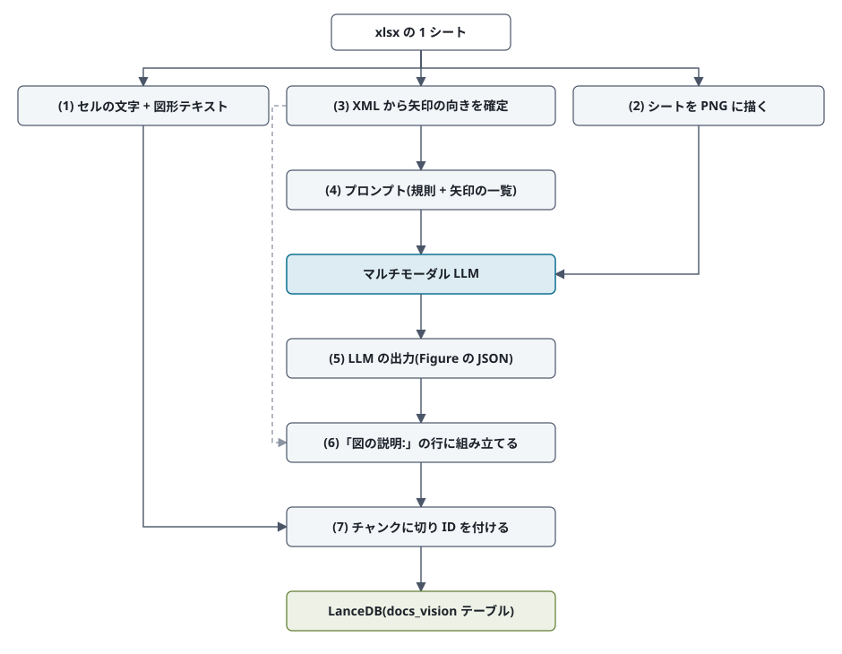
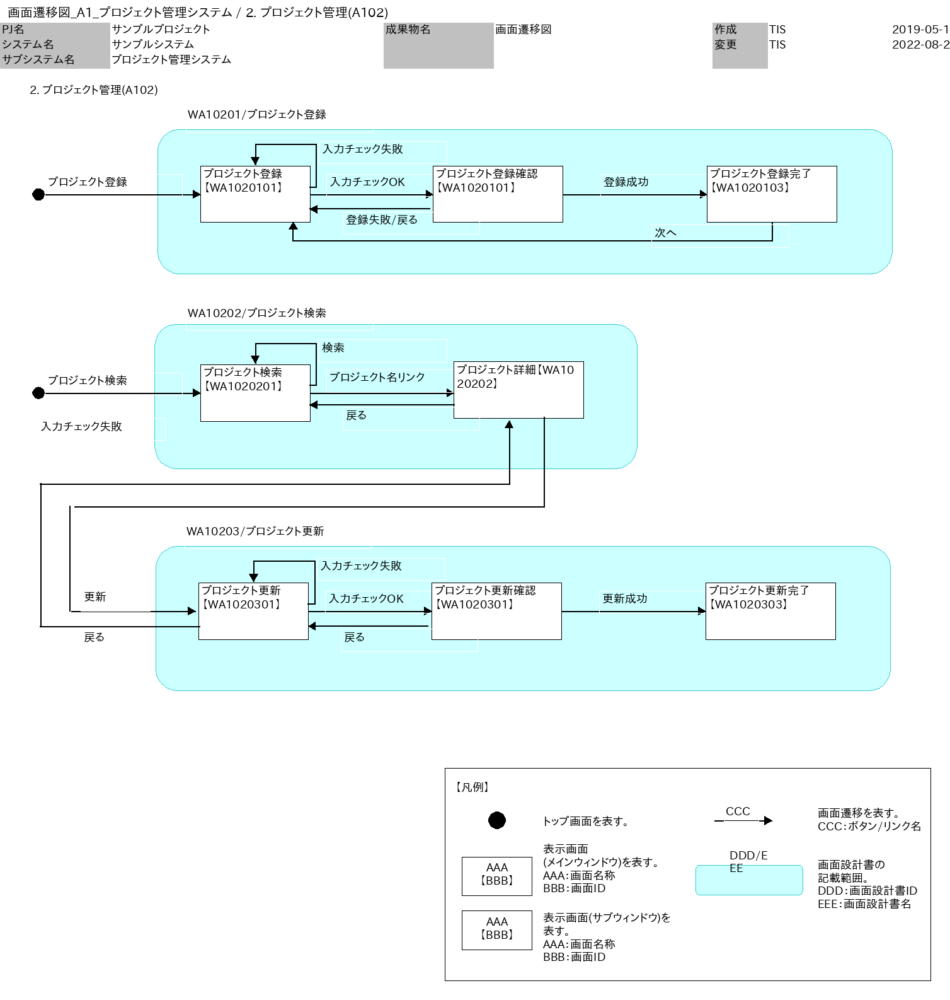
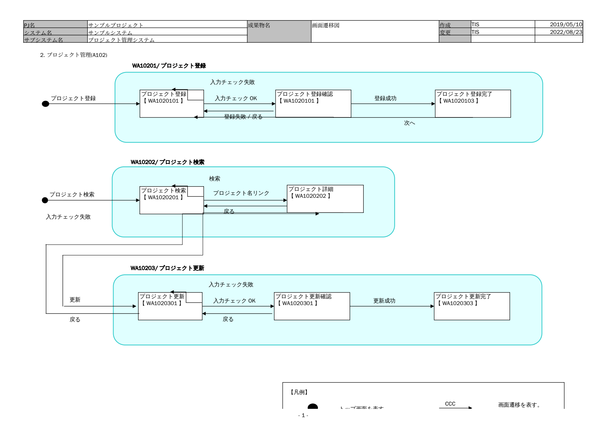
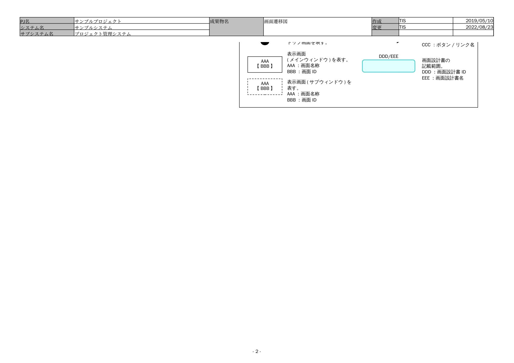

# 段階 4: 画面遷移図のシートをマルチモーダル LLM で読む

段階 4(vision 抽出器)では、インデックス作成時に xlsx のシートを画像にしてマルチモーダル LLM に読ませ、
図の説明をテキストに足してから DB に登録します。ここでは画面遷移図の 1 シートを例に、
xlsx から何を取り出し、LLM に何を渡し、何が返り、最終的に何が DB に入るかを順に見ていきます。
LLM の出力は実行のたびに少し変わるので、以下の出力例は一例です。

## 題材

- ファイル: `data/corpus/システム開発/A1_プロジェクト管理システム/010_要件定義/040_画面設計/画面遷移図_A1_プロジェクト管理システム.xlsx`
- シート: `2. プロジェクト管理(A102)`

画面(箱)と遷移(矢印とラベル)が Excel の図形で描かれていて、セルには見出ししか書かれていません。
段階 3 までは図形の中の文字を出現順に並べるだけなので、「どの箱からどの箱へ矢印が向いているか」が失われます。

## 前提: xlsx ファイルの中身

この後の説明に出てくる openpyxl と drawing XML を押さえておきます。xlsx は実は zip ファイルで、拡張子を .zip に変えて展開すると
XML ファイルの集まりが出てきます。この画面遷移図のブックを展開すると、次のようなファイルが入っています(抜粋)。

```text
xl/workbook.xml                     シートの一覧(名前と、どのファイルがそのシートかの対応)
xl/sharedStrings.xml                セルに入っている文字列の一覧(セル側は番号で参照する)
xl/worksheets/sheet5.xml            シート「2. プロジェクト管理(A102)」のセルの値
xl/worksheets/_rels/sheet5.xml.rels このシートが使う図形ファイルへの対応(→ drawing3.xml)
xl/drawings/drawing3.xml            このシートに描かれた図形(箱、矢印、文字)
```

**セルの値**は `xl/worksheets/sheet5.xml` に入っています。たとえば見出しのセル B5 は次の 1 行で、`t="s"` は文字列、
`<v>27</v>` は `sharedStrings.xml` の 27 番目の文字列(「2. プロジェクト管理(A102)」)を指します。

```xml
<row r="5"><c r="B5" s="43" t="s"><v>27</v></c></row>
```

**openpyxl** は、この XML を読んで `ws["B5"].value` のようにセルの値を取り出せるようにする Python ライブラリです。
段階 3 の structured 抽出器はこれでセルを読んでいます。ただし openpyxl は図形を扱いません(図形のあるブックを読んで保存すると図形が消えます)。

**図形**はセルとは別のファイル `xl/drawings/drawing3.xml` に入っています。形式は DrawingML と呼ばれる XML で、
pptx のスライドの図形と同じ書き方です。箱は `xdr:sp`、矢印などのコネクタは `xdr:cxnSp` という要素で、
このシートには箱などの図形が 50 個、コネクタが 20 本あります。実物を 2 つ、属性を省いて載せます。

箱「プロジェクト登録【WA1020101】」(`id="4"`):

```xml
<xdr:sp>
  <xdr:nvSpPr><xdr:cNvPr id="4" name="Rectangle 274"/></xdr:nvSpPr>
  <xdr:spPr>
    <a:xfrm><a:off x="2013962" y="1442831"/><a:ext cx="1100667" cy="592667"/></a:xfrm>  <!-- 位置と大きさ(EMU。1 cm = 360000) -->
    <a:prstGeom prst="rect"/>                                                              <!-- 形: 長方形 -->
  </xdr:spPr>
  <xdr:txBody>
    <a:p><a:r><a:t>プロジェクト登録</a:t></a:r></a:p>                                        <!-- 1 段落目 -->
    <a:p><a:r><a:t>【</a:t></a:r><a:r><a:t>WA1020101</a:t></a:r><a:r><a:t>】</a:t></a:r></a:p>  <!-- 2 段落目。書式ごとに a:r が分かれる -->
  </xdr:txBody>
</xdr:sp>
```

矢印「プロジェクト登録 → プロジェクト登録確認」(ラベル「入力チェックOK」の線):

```xml
<xdr:cxnSp>
  <xdr:nvCxnSpPr>
    <xdr:cNvPr id="23" name="直線矢印コネクタ 22"/>
    <xdr:cNvCxnSpPr>
      <a:stCxn id="4" idx="3"/>    <!-- 始点は id=4 の図形(プロジェクト登録)の接続点 3 -->
      <a:endCxn id="54" idx="1"/>  <!-- 終点は id=54 の図形(プロジェクト登録確認)の接続点 1 -->
    </xdr:cNvCxnSpPr>
  </xdr:nvCxnSpPr>
  <xdr:spPr>
    <a:xfrm><a:off x="3114629" y="1739164"/><a:ext cx="1237743" cy="0"/></a:xfrm>
    <a:prstGeom prst="straightConnector1"/>
    <a:ln>
      <a:headEnd type="none"/>      <!-- 始点側に矢じりなし -->
      <a:tailEnd type="triangle"/>  <!-- 終点側に三角の矢じり = 向きは 4 → 54 -->
    </a:ln>
  </xdr:spPr>
</xdr:cxnSp>
```

ここから分かることが、この後の処理のもとになります。

- 文字は `a:t` に入っていますが、書式が変わるごとに `a:r` が分かれます。(1) の `図形テキスト:` で「プロジェクト登録 / 【 / WA1020101 / 】」のように割れて並ぶのはこのためです。
- 矢印の接続先(`stCxn` / `endCxn`)と矢じりの側(`headEnd` / `tailEnd`)は XML に書いてあります。(2) の自前描画と (3) の矢印の確定はこれを読んでいます。矢印のラベル「入力チェックOK」は矢印の属性ではなく、線の近くに置かれた別の文字の図形なので、位置の近さで対応付けます。
- 接続先が書かれていない矢印(箱に重ねて置いただけのもの)もあります。その端は座標から最も近い箱を探し、近くに箱が無ければ「(図形なし)」として一覧に出し、画像を見た LLM に最も近い要素を選ばせます。

## 処理の流れ



番号は以下の節に対応します。(1)(2)(3) は xlsx から取り出す 3 つの材料、(4)(5) が LLM への入出力、(6)(7) が DB に入れるテキストへの組み立てです。

## (1) xlsx から取り出したテキスト(段階 3 と同じ)

openpyxl でセルを読み、図形の中の文字は drawing XML から出現順に拾って `図形テキスト:` の 1 行にします。
「プロジェクト名リンク」「戻る」は出てきますが、どの箱の間の矢印のラベルかは分かりません。
この 2 行は段階 4 でもそのまま残します(キーワード一致の全文検索に効くため)。

コード: `app/advanced_rag/extractors/structured.py`

```text
2. プロジェクト管理(A102)
図形テキスト: AAA / 【BBB】 / 【凡例】 / CCC / 表示画面 / (メインウィンドウ)を表す。 / AAA：画面名称 / BBB：画面ID / 画面遷移を表す。 / CCC：ボタン/リンク名 / トップ画面を表す。 / DDD / / / EEE / 画面設計書の / 記載範囲。 / DDD / ：画面設計書ID / EEE / ：画面設計書名 / AAA / 【BBB】 / 表示画面(サブウィンドウ)を表す。 / AAA：画面名称 / BBB：画面ID / WA10201/ / プロジェクト登録 / プロジェクト登録 / 【 / WA1020101 / 】 / 入力チェック失敗 / 入力チェック / OK / プロジェクト登録確認 / 【 / WA1020101 / 】 / 登録成功 / プロジェクト登録完了 / 【 / WA1020103 / 】 / 登録失敗 / / / 戻る / プロジェクト登録 / 次へ / WA10202/ / プロジェクト検索 / プロジェクト検索 / 【 / WA1020201 / 】 / 検索 / プロジェクト検索 / プロジェクト名リンク / プロジェクト詳細【 / WA1020202 / 】 / 戻る / WA10203/ / プロジェクト更新 / プロジェクト更新 / 【 / WA1020301 / 】 / 入力チェック失敗 / 入力チェック / OK / プロジェクト更新確認 / 【 / WA1020301 / 】 / 更新成功 / プロジェクト更新完了 / 【 / WA1020303 / 】 / 戻る / 入力チェック失敗 / 更新 / 戻る
```

## (2) LLM に渡す画像

openpyxl では図形を描けないので、`app/advanced_rag/extractors/render_drawing.py` が drawing XML を読み、
セル・図形・矢印・ラベルを自前で PNG に描きます。Excel と同じ見た目は目指さず、箱・ラベル・矢印の向きが読めればよい、
という描き方です。これをそのまま画像入力として送ります(長い辺が 2000 px を超えるときは縮小)。

画像は 1508 × 1586 px、約 140 KB です。



## (2b) Excel や LibreOffice に描かせなかった理由

**Excel 自体に PDF を出力させればよいのでは?** と思うかもしれませんが、インデックス作成のようなサーバー側の処理には使えません。

- Excel はデスクトップアプリで、動作環境は Windows と macOS だけです(Microsoft の [動作要件](https://support.microsoft.com/en-us/office/system-requirements-for-microsoft-365-for-business-education-and-government-use) に Linux はありません)。外部のプログラムから Excel を操作する仕組み(COM オートメーション)は Windows 専用なので、Linux のサーバーやコンテナでは動かせません。
- Microsoft は、サービスや Web アプリのような無人・非対話の環境から Office を自動操作することを推奨せず、サポートもしていません。さらに、サーバー上の Office でクライアントの要求を処理することはライセンス上も認められていません(要求元がそれぞれ Office のライセンスを持つ場合を除く)。出典: Microsoft の技術情報 [Considerations for server-side Automation of Office (KB 257757)](https://support.microsoft.com/en-us/help/257757)。

**次に LibreOffice を試しました。** LibreOffice(`soffice --headless --convert-to pdf`)でシートを PDF にし、ページを画像にして LLM に渡していました。
しかし折れ線コネクタの経路を LibreOffice が正しく再現できず、矢印の先がつながらない画像になりました。
下はこのシートを LibreOffice 7.4 で描かせたそのままの結果です。上の (2) と見比べると:

- 「次へ」(プロジェクト登録完了 → プロジェクト登録)の線が描かれず、ラベルだけが残っている
- プロジェクト更新とプロジェクト詳細をつなぐ 2 本(「更新」「戻る」)が、プロジェクト詳細ではなくプロジェクト検索の箱の下辺から出て、矢じりが箱の無い場所に着いている
- 自分自身に戻る矢印(「入力チェック失敗」「検索」)が、箱の右上に重なる小さな四角として描かれ、経路が読めない
- 印刷ページの区切りでシートが 2 枚に割れ、凡例が途中で切れている

矢印の向きと接続先が読めない画像を渡しても、正しい遷移は返ってきません。そこで drawing XML から箱と矢印の接続先
(stCxn / endCxn)を直接読んで描く `render_drawing.py` を書きました。LibreOffice は、Pillow が開けない EMF / WMF 画像を
PNG にする用途にだけ今も使っています。

1 ページ目。「次へ」の線が無く、下の 2 本がプロジェクト検索の箱から出ている:



2 ページ目。凡例の続きだけが載る:



## (3) drawing XML から確定した矢印の一覧

コネクタ図形がどの図形に接続しているか、矢じりがどちらの端にあるか、近くのラベル図形は何かを XML から読み、
17 本の矢印を `A1 … A17` の一覧にします。LLM は矢印の向きを逆に読むことがあるので、
機械的に決められるものは先に決めてプロンプトの末尾に添えます。

コード: `app/advanced_rag/extractors/arrows.py`

```text
# 矢印の一覧(向きとラベルは図形の情報から確定済み。座標は画像の画素で 始点→終点)
この一覧の矢印は、向きとラベルをこのとおりにして arrows に入れてください(ラベルの無いものは画像から読む)。「(図形なし)」の端は、画像を見てその端に最も近い要素を source / target にしてください(「図形なし」とは書かない)。
A1 [1135, 1302]→[1226, 1302] (図形なし) → (図形なし) ラベル「CCC」
A2 [492, 308]→[688, 308] 「プロジェクト登録 【WA1020101】」 → 「プロジェクト登録確認 【WA1020101】」 ラベル「入力チェックOK」
A3 [491, 296]→[405, 261] 「プロジェクト登録 【WA1020101】」 → 「プロジェクト登録 【WA1020101】」 ラベル「入力チェック失敗」
A4 [70, 308]→[318, 308] (図形なし) → 「プロジェクト登録 【WA1020101】」 ラベル「プロジェクト登録」
A5 [894, 308]→[1123, 308] 「プロジェクト登録確認 【WA1020101】」 → 「プロジェクト登録完了 【WA1020103】」 ラベル「登録成功」
A6 [683, 332]→[492, 332] 「プロジェクト登録確認 【WA1020101】」 → 「プロジェクト登録 【WA1020101】」 ラベル「登録失敗/戻る」
A7 [1226, 353]→[465, 352] 「プロジェクト登録完了 【WA1020103】」 → 「プロジェクト登録 【WA1020101】」 ラベル「次へ」
A8 [491, 611]→[405, 577] 「プロジェクト検索 【WA1020201】」 → 「プロジェクト検索 【WA1020201】」 ラベル「検索」
A9 [70, 623]→[318, 623] (図形なし) → 「プロジェクト検索 【WA1020201】」 ラベル「プロジェクト検索」
A10 [492, 623]→[721, 623] 「プロジェクト検索 【WA1020201】」 → 「プロジェクト詳細【WA1020202】」 ラベル「プロジェクト名リンク」
A11 [722, 642]→[492, 642] 「プロジェクト詳細【WA1020202】」 → 「プロジェクト検索 【WA1020201】」 ラベル「戻る」
A12 [490, 969]→[685, 969] 「プロジェクト更新 【WA1020301】」 → 「プロジェクト更新確認 【WA1020301】」 ラベル「入力チェックOK」
A13 [489, 957]→[402, 923] 「プロジェクト更新 【WA1020301】」 → 「プロジェクト更新 【WA1020301】」 ラベル「入力チェック失敗」
A14 [114, 969]→[310, 969] (図形なし) → 「プロジェクト更新 【WA1020301】」 ラベル「更新」
A15 [891, 969]→[1120, 969] 「プロジェクト更新確認 【WA1020301】」 → 「プロジェクト更新完了 【WA1020303】」 ラベル「更新成功」
A16 [680, 993]→[489, 993] 「プロジェクト更新確認 【WA1020301】」 → 「プロジェクト更新 【WA1020301】」 ラベル「戻る」
A17 [63, 768]→[808, 667] 「プロジェクト更新 【WA1020301】」 → 「プロジェクト詳細【WA1020202】」 ラベル「戻る」
```

## (4) プロンプト全文

題材によらない「図の読み方の規則」と「返す JSON の形」だけを書き(`figure_rules.py` の RULES / OMIT / SCHEMA)、
末尾に (3) の矢印一覧を添えます。(2) の画像と合わせて gpt-6-luna(reasoning_effort=low)に Structured Outputs で送ります。

コード: `app/advanced_rag/extractors/vision.py` の `PROMPT`(約 3,383 文字)

<details>
<summary>プロンプト全文を開く</summary>

```text
これは Excel の 1 シートを、セルの文字・図形・貼り付けられた画像ごと画像にしたものです。
図に描かれている内容を、検索で引けるように過不足なく書き出してください。

- 矢印や線でつながれた要素は、1 本ずつ arrows に入れる(source が元、target が先)。両向きの矢印は bidirectional を true にし、同じ要素に戻る矢印も入れる。矢印は複数の直線をつないだ折れ線で描かれていることがあるので、線を端までたどり、矢じり(三角)の付いている側を target とする。label は線の近くに書かれた文字で、要素ではない。「矢印の一覧」が渡されていれば、そこにある矢印の向きは一覧に従う(一覧に無い矢印は画像から読む)
- 入れ子(大きな枠の中の小さな箱)は「大枠 > 小箱」のように所属が分かるように facts に書く
- 箱の並び(上下・左右の対応)で関係が表されていれば、その対応を書く。特に、1 つの枠の中に箱が左右に並び、その上または下の枠にも同じ数の箱が並んでいれば、列がそろっていることが対応を表しているので、同じ列の上下の箱を pairs に 1 組ずつ必ず入れる(upper が上の箱、lower が下の箱。例: upper「本社」lower「東日本エリア」)。位置(「下段右」など)を facts に書くだけで済ませない
- 数値(金額、件数、日付、割合)がどの要素・どの項目のものかが配置でしか分からなければ、その対応を facts に書く
- チェックボックス・ラジオボタンは「項目名: 選択されている選択肢」の形で facts に書く。灰色などで使われていないことが示された欄は書かない
- 画面キャプチャや画面レイアウト: 画面・ダイアログ・メニューの名前、項目名(横にショートカットキーがあればそれも)、ボタン・リンク、チェックボックスの状態、表示されているメッセージの文言、入力値や表示値、丸や枠で強調された箇所を facts に書く
- 番号・引き出し線・吹き出しの注記は、番号と名称だけでなく、それが指している箇所(例:「③ ツールバー: メニューバーの下のアイコンの列」)も facts に書く
- 表は行ごとに「項目 | 値 | 値」の形で facts に書く。グラフは、系列ごとに、目盛から読み取れる値を軸の項目(年、年齢階級など)ごとに facts に書く(例:「売上高: 2020年 約120 / 2021年 約135」。対数目盛なら目盛の値から読む)。上昇・低下などの傾向だけで済ませず、値を書く。値が読めない場合も、同じ軸の項目での系列の大小の順(例:「2020年: 売上高 > 営業利益 > 純利益」)を書く
- 要素に ID・コード・番号が書かれていれば、名前に続けて書く(例:「顧客一覧画面 [SC-001]」)
- 帳票の欄に文字で書かれた値(例:「担当部署 営業部」)も「項目名: 値」の形で facts に書く

凡例、出典、ページ番号、ヘッダ/フッタ、飾りの枠、どのページ・シートにも付く定型の枠(文書名、作成者、日付など)は書かない。図や画像に無いことを推測で補わない。

JSON で {"arrows": [...], "pairs": [...], "facts": [...]} の形で返してください。
- arrows: 矢印 1 本ごとに {"source": 元の要素, "target": 先の要素, "label": 線の近くのラベル(無ければ ""), "bidirectional": 両向きなら true, "after": 行番号}
- pairs: 箱の列の上下の対応 1 組ごとに {"upper": 上の箱, "lower": 下の箱, "after": 行番号}
- facts: それ以外の説明 1 件ごとに {"text": "説明 1 行", "after": 行番号}。1 件には 1 つの事実だけを書き、段落にまとめない(画面キャプチャなら、画面名、項目 1 つ、メッセージ 1 つ、強調箇所 1 つがそれぞれ 1 件)
要素の名前は図に書かれた文字のとおりに書く。画像から読み取れることは省かずに全部書く。図も画像も無ければ 3 つとも空の配列にしてください。
after は使わないので 0 にしてください。

# 矢印の一覧(向きとラベルは図形の情報から確定済み。座標は画像の画素で 始点→終点)
この一覧の矢印は、向きとラベルをこのとおりにして arrows に入れてください(ラベルの無いものは画像から読む)。「(図形なし)」の端は、画像を見てその端に最も近い要素を source / target にしてください(「図形なし」とは書かない)。
A1 [1135, 1302]→[1226, 1302] (図形なし) → (図形なし) ラベル「CCC」
A2 [492, 308]→[688, 308] 「プロジェクト登録 【WA1020101】」 → 「プロジェクト登録確認 【WA1020101】」 ラベル「入力チェックOK」
A3 [491, 296]→[405, 261] 「プロジェクト登録 【WA1020101】」 → 「プロジェクト登録 【WA1020101】」 ラベル「入力チェック失敗」
A4 [70, 308]→[318, 308] (図形なし) → 「プロジェクト登録 【WA1020101】」 ラベル「プロジェクト登録」
A5 [894, 308]→[1123, 308] 「プロジェクト登録確認 【WA1020101】」 → 「プロジェクト登録完了 【WA1020103】」 ラベル「登録成功」
A6 [683, 332]→[492, 332] 「プロジェクト登録確認 【WA1020101】」 → 「プロジェクト登録 【WA1020101】」 ラベル「登録失敗/戻る」
A7 [1226, 353]→[465, 352] 「プロジェクト登録完了 【WA1020103】」 → 「プロジェクト登録 【WA1020101】」 ラベル「次へ」
A8 [491, 611]→[405, 577] 「プロジェクト検索 【WA1020201】」 → 「プロジェクト検索 【WA1020201】」 ラベル「検索」
A9 [70, 623]→[318, 623] (図形なし) → 「プロジェクト検索 【WA1020201】」 ラベル「プロジェクト検索」
A10 [492, 623]→[721, 623] 「プロジェクト検索 【WA1020201】」 → 「プロジェクト詳細【WA1020202】」 ラベル「プロジェクト名リンク」
A11 [722, 642]→[492, 642] 「プロジェクト詳細【WA1020202】」 → 「プロジェクト検索 【WA1020201】」 ラベル「戻る」
A12 [490, 969]→[685, 969] 「プロジェクト更新 【WA1020301】」 → 「プロジェクト更新確認 【WA1020301】」 ラベル「入力チェックOK」
A13 [489, 957]→[402, 923] 「プロジェクト更新 【WA1020301】」 → 「プロジェクト更新 【WA1020301】」 ラベル「入力チェック失敗」
A14 [114, 969]→[310, 969] (図形なし) → 「プロジェクト更新 【WA1020301】」 ラベル「更新」
A15 [891, 969]→[1120, 969] 「プロジェクト更新確認 【WA1020301】」 → 「プロジェクト更新完了 【WA1020303】」 ラベル「更新成功」
A16 [680, 993]→[489, 993] 「プロジェクト更新確認 【WA1020301】」 → 「プロジェクト更新 【WA1020301】」 ラベル「戻る」
A17 [63, 768]→[808, 667] 「プロジェクト更新 【WA1020301】」 → 「プロジェクト詳細【WA1020202】」 ラベル「戻る」
```

</details>

## (5) LLM の出力

Figure の JSON(arrows / pairs / facts)。Structured Outputs なので必ずこの形で返ります。
文面はまだ決めさせず、要素名と向きとラベルだけを返させます。この例では arrows 17 本、facts 10 件、pairs 0 件でした。

arrows の例:

```json
{
  "source": "プロジェクト検索 【WA1020201】",
  "target": "プロジェクト詳細【WA1020202】",
  "label": "プロジェクト名リンク",
  "bidirectional": false,
  "after": 0
}
```

facts の例:

```json
{
  "text": "WA10202/プロジェクト検索 > プロジェクト詳細【WA1020202】",
  "after": 0
}
```

<details>
<summary>出力の JSON 全文を開く</summary>

```json
{
  "arrows": [
    {
      "source": "CCC",
      "target": "画面遷移を表す。CCC:ボタン/リンク名",
      "label": "CCC",
      "bidirectional": false,
      "after": 0
    },
    {
      "source": "プロジェクト登録 【WA1020101】",
      "target": "プロジェクト登録確認 【WA1020101】",
      "label": "入力チェックOK",
      "bidirectional": false,
      "after": 0
    },
    {
      "source": "プロジェクト登録 【WA1020101】",
      "target": "プロジェクト登録 【WA1020101】",
      "label": "入力チェック失敗",
      "bidirectional": false,
      "after": 0
    },
    {
      "source": "プロジェクト登録",
      "target": "プロジェクト登録 【WA1020101】",
      "label": "プロジェクト登録",
      "bidirectional": false,
      "after": 0
    },
    {
      "source": "プロジェクト登録確認 【WA1020101】",
      "target": "プロジェクト登録完了 【WA1020103】",
      "label": "登録成功",
      "bidirectional": false,
      "after": 0
    },
    {
      "source": "プロジェクト登録確認 【WA1020101】",
      "target": "プロジェクト登録 【WA1020101】",
      "label": "登録失敗/戻る",
      "bidirectional": false,
      "after": 0
    },
    {
      "source": "プロジェクト登録完了 【WA1020103】",
      "target": "プロジェクト登録 【WA1020101】",
      "label": "次へ",
      "bidirectional": false,
      "after": 0
    },
    {
      "source": "プロジェクト検索 【WA1020201】",
      "target": "プロジェクト検索 【WA1020201】",
      "label": "検索",
      "bidirectional": false,
      "after": 0
    },
    {
      "source": "プロジェクト検索",
      "target": "プロジェクト検索 【WA1020201】",
      "label": "プロジェクト検索",
      "bidirectional": false,
      "after": 0
    },
    {
      "source": "プロジェクト検索 【WA1020201】",
      "target": "プロジェクト詳細【WA1020202】",
      "label": "プロジェクト名リンク",
      "bidirectional": false,
      "after": 0
    },
    {
      "source": "プロジェクト詳細【WA1020202】",
      "target": "プロジェクト検索 【WA1020201】",
      "label": "戻る",
      "bidirectional": false,
      "after": 0
    },
    {
      "source": "プロジェクト更新 【WA1020301】",
      "target": "プロジェクト更新確認 【WA1020301】",
      "label": "入力チェックOK",
      "bidirectional": false,
      "after": 0
    },
    {
      "source": "プロジェクト更新 【WA1020301】",
      "target": "プロジェクト更新 【WA1020301】",
      "label": "入力チェック失敗",
      "bidirectional": false,
      "after": 0
    },
    {
      "source": "更新",
      "target": "プロジェクト更新 【WA1020301】",
      "label": "更新",
      "bidirectional": false,
      "after": 0
    },
    {
      "source": "プロジェクト更新確認 【WA1020301】",
      "target": "プロジェクト更新完了 【WA1020303】",
      "label": "更新成功",
      "bidirectional": false,
      "after": 0
    },
    {
      "source": "プロジェクト更新確認 【WA1020301】",
      "target": "プロジェクト更新 【WA1020301】",
      "label": "戻る",
      "bidirectional": false,
      "after": 0
    },
    {
      "source": "プロジェクト更新 【WA1020301】",
      "target": "プロジェクト詳細【WA1020202】",
      "label": "戻る",
      "bidirectional": false,
      "after": 0
    }
  ],
  "pairs": [],
  "facts": [
    {
      "text": "画面遷移図の対象: 2. プロジェクト管理(A102)",
      "after": 0
    },
    {
      "text": "WA10201/プロジェクト登録 > プロジェクト登録 【WA1020101】",
      "after": 0
    },
    {
      "text": "WA10201/プロジェクト登録 > プロジェクト登録確認 【WA1020101】",
      "after": 0
    },
    {
      "text": "WA10201/プロジェクト登録 > プロジェクト登録完了 【WA1020103】",
      "after": 0
    },
    {
      "text": "WA10202/プロジェクト検索 > プロジェクト検索 【WA1020201】",
      "after": 0
    },
    {
      "text": "WA10202/プロジェクト検索 > プロジェクト詳細【WA1020202】",
      "after": 0
    },
    {
      "text": "WA10203/プロジェクト更新 > プロジェクト更新 【WA1020301】",
      "after": 0
    },
    {
      "text": "WA10203/プロジェクト更新 > プロジェクト更新確認 【WA1020301】",
      "after": 0
    },
    {
      "text": "WA10203/プロジェクト更新 > プロジェクト更新完了 【WA1020303】",
      "after": 0
    },
    {
      "text": "プロジェクト検索図の左側に「入力チェック失敗」と表示されている",
      "after": 0
    }
  ]
}
```

</details>

## (6) 「図の説明:」の行に組み立てる

文面は LLM に書かせず、`vision.figure_lines()` がコードで決めます。矢印は `A --ラベル--> B`、入れ子や注記は facts のまま、
2 つ以上の元から矢印が入る要素には `X に入る矢印の元: A(ラベル) / B(ラベル)` を 1 行にまとめます
(ある画面への遷移元を全部聞かれたときに、離れた行を探さずに済むように)。
LLM が矢印を逆向きに返していれば、(3) の一覧に合わせてここで直します。

コード: `app/advanced_rag/extractors/vision.py` の `figure_lines()`(31 行)

```text
図の説明: 画面遷移図の対象: 2. プロジェクト管理(A102)
図の説明: WA10201/プロジェクト登録 > プロジェクト登録 【WA1020101】
図の説明: WA10201/プロジェクト登録 > プロジェクト登録確認 【WA1020101】
図の説明: WA10201/プロジェクト登録 > プロジェクト登録完了 【WA1020103】
図の説明: WA10202/プロジェクト検索 > プロジェクト検索 【WA1020201】
図の説明: WA10202/プロジェクト検索 > プロジェクト詳細【WA1020202】
図の説明: WA10203/プロジェクト更新 > プロジェクト更新 【WA1020301】
図の説明: WA10203/プロジェクト更新 > プロジェクト更新確認 【WA1020301】
図の説明: WA10203/プロジェクト更新 > プロジェクト更新完了 【WA1020303】
図の説明: プロジェクト検索図の左側に「入力チェック失敗」と表示されている
図の説明: CCC --CCC--> 画面遷移を表す。CCC:ボタン/リンク名
図の説明: プロジェクト登録 【WA1020101】 --入力チェックOK--> プロジェクト登録確認 【WA1020101】
図の説明: プロジェクト登録 【WA1020101】 --入力チェック失敗--> プロジェクト登録 【WA1020101】
図の説明: プロジェクト登録 --プロジェクト登録--> プロジェクト登録 【WA1020101】
図の説明: プロジェクト登録確認 【WA1020101】 --登録成功--> プロジェクト登録完了 【WA1020103】
図の説明: プロジェクト登録確認 【WA1020101】 --登録失敗/戻る--> プロジェクト登録 【WA1020101】
図の説明: プロジェクト登録完了 【WA1020103】 --次へ--> プロジェクト登録 【WA1020101】
図の説明: プロジェクト検索 【WA1020201】 --検索--> プロジェクト検索 【WA1020201】
図の説明: プロジェクト検索 --プロジェクト検索--> プロジェクト検索 【WA1020201】
図の説明: プロジェクト検索 【WA1020201】 --プロジェクト名リンク--> プロジェクト詳細【WA1020202】
図の説明: プロジェクト詳細【WA1020202】 --戻る--> プロジェクト検索 【WA1020201】
図の説明: プロジェクト更新 【WA1020301】 --入力チェックOK--> プロジェクト更新確認 【WA1020301】
図の説明: プロジェクト更新 【WA1020301】 --入力チェック失敗--> プロジェクト更新 【WA1020301】
図の説明: 更新 --更新--> プロジェクト更新 【WA1020301】
図の説明: プロジェクト更新確認 【WA1020301】 --更新成功--> プロジェクト更新完了 【WA1020303】
図の説明: プロジェクト更新確認 【WA1020301】 --戻る--> プロジェクト更新 【WA1020301】
図の説明: プロジェクト更新 【WA1020301】 --戻る--> プロジェクト詳細【WA1020202】
図の説明: プロジェクト登録 【WA1020101】 に入る矢印の元: プロジェクト登録(プロジェクト登録) / プロジェクト登録確認 【WA1020101】(登録失敗/戻る) / プロジェクト登録完了 【WA1020103】(次へ)
図の説明: プロジェクト検索 【WA1020201】 に入る矢印の元: プロジェクト検索(プロジェクト検索) / プロジェクト詳細【WA1020202】(戻る)
図の説明: プロジェクト詳細【WA1020202】 に入る矢印の元: プロジェクト検索 【WA1020201】(プロジェクト名リンク) / プロジェクト更新 【WA1020301】(戻る)
図の説明: プロジェクト更新 【WA1020301】 に入る矢印の元: 更新(更新) / プロジェクト更新確認 【WA1020301】(戻る)
```

## (7) DB に登録するレコード

(1) の 2 行の後ろに (6) の行を足し、3,000 文字を目安にチャンクに切ります(このシートは 1 チャンク)。
`ingest.py` が ID とメタ情報を付けて JSONL に書き出し、text-embedding-3-small で埋め込んで
LanceDB のテーブルに入れます。ID は `corpus からの相対パス#シート名`、`collection` は資料群の絞り込み、
`seq` はファイル内でのチャンクの順番(前後のチャンクを引くのに使う)です。

コード: `app/advanced_rag/ingest.py`

```json
{
  "id": "システム開発/A1_プロジェクト管理システム/010_要件定義/040_画面設計/画面遷移図_A1_プロジェクト管理システム#2. プロジェクト管理(A102)",
  "title": "システム開発 / A1_プロジェクト管理システム / 010_要件定義 / 040_画面設計 / 画面遷移図_A1_プロジェクト管理システム / 2. プロジェクト管理(A102)",
  "text": "(下の本文)",
  "collection": "システム開発",
  "file": "システム開発/A1_プロジェクト管理システム/010_要件定義/040_画面設計/画面遷移図_A1_プロジェクト管理システム.xlsx",
  "sheet": "2. プロジェクト管理(A102)",
  "unit": "2. プロジェクト管理(A102)",
  "seq": 3
}
```

text(2,506 文字):

```text
2. プロジェクト管理(A102)
図形テキスト: AAA / 【BBB】 / 【凡例】 / CCC / 表示画面 / (メインウィンドウ)を表す。 / AAA：画面名称 / BBB：画面ID / 画面遷移を表す。 / CCC：ボタン/リンク名 / トップ画面を表す。 / DDD / / / EEE / 画面設計書の / 記載範囲。 / DDD / ：画面設計書ID / EEE / ：画面設計書名 / AAA / 【BBB】 / 表示画面(サブウィンドウ)を表す。 / AAA：画面名称 / BBB：画面ID / WA10201/ / プロジェクト登録 / プロジェクト登録 / 【 / WA1020101 / 】 / 入力チェック失敗 / 入力チェック / OK / プロジェクト登録確認 / 【 / WA1020101 / 】 / 登録成功 / プロジェクト登録完了 / 【 / WA1020103 / 】 / 登録失敗 / / / 戻る / プロジェクト登録 / 次へ / WA10202/ / プロジェクト検索 / プロジェクト検索 / 【 / WA1020201 / 】 / 検索 / プロジェクト検索 / プロジェクト名リンク / プロジェクト詳細【 / WA1020202 / 】 / 戻る / WA10203/ / プロジェクト更新 / プロジェクト更新 / 【 / WA1020301 / 】 / 入力チェック失敗 / 入力チェック / OK / プロジェクト更新確認 / 【 / WA1020301 / 】 / 更新成功 / プロジェクト更新完了 / 【 / WA1020303 / 】 / 戻る / 入力チェック失敗 / 更新 / 戻る
図の説明: 画面遷移図の対象: 2. プロジェクト管理(A102)
図の説明: WA10201/プロジェクト登録 > プロジェクト登録 【WA1020101】
図の説明: WA10201/プロジェクト登録 > プロジェクト登録確認 【WA1020101】
図の説明: WA10201/プロジェクト登録 > プロジェクト登録完了 【WA1020103】
図の説明: WA10202/プロジェクト検索 > プロジェクト検索 【WA1020201】
図の説明: WA10202/プロジェクト検索 > プロジェクト詳細【WA1020202】
図の説明: WA10203/プロジェクト更新 > プロジェクト更新 【WA1020301】
図の説明: WA10203/プロジェクト更新 > プロジェクト更新確認 【WA1020301】
図の説明: WA10203/プロジェクト更新 > プロジェクト更新完了 【WA1020303】
図の説明: プロジェクト検索図の左側に「入力チェック失敗」と表示されている
図の説明: CCC --CCC--> 画面遷移を表す。CCC:ボタン/リンク名
図の説明: プロジェクト登録 【WA1020101】 --入力チェックOK--> プロジェクト登録確認 【WA1020101】
図の説明: プロジェクト登録 【WA1020101】 --入力チェック失敗--> プロジェクト登録 【WA1020101】
図の説明: プロジェクト登録 --プロジェクト登録--> プロジェクト登録 【WA1020101】
図の説明: プロジェクト登録確認 【WA1020101】 --登録成功--> プロジェクト登録完了 【WA1020103】
図の説明: プロジェクト登録確認 【WA1020101】 --登録失敗/戻る--> プロジェクト登録 【WA1020101】
図の説明: プロジェクト登録完了 【WA1020103】 --次へ--> プロジェクト登録 【WA1020101】
図の説明: プロジェクト検索 【WA1020201】 --検索--> プロジェクト検索 【WA1020201】
図の説明: プロジェクト検索 --プロジェクト検索--> プロジェクト検索 【WA1020201】
図の説明: プロジェクト検索 【WA1020201】 --プロジェクト名リンク--> プロジェクト詳細【WA1020202】
図の説明: プロジェクト詳細【WA1020202】 --戻る--> プロジェクト検索 【WA1020201】
図の説明: プロジェクト更新 【WA1020301】 --入力チェックOK--> プロジェクト更新確認 【WA1020301】
図の説明: プロジェクト更新 【WA1020301】 --入力チェック失敗--> プロジェクト更新 【WA1020301】
図の説明: 更新 --更新--> プロジェクト更新 【WA1020301】
図の説明: プロジェクト更新確認 【WA1020301】 --更新成功--> プロジェクト更新完了 【WA1020303】
図の説明: プロジェクト更新確認 【WA1020301】 --戻る--> プロジェクト更新 【WA1020301】
図の説明: プロジェクト更新 【WA1020301】 --戻る--> プロジェクト詳細【WA1020202】
図の説明: プロジェクト登録 【WA1020101】 に入る矢印の元: プロジェクト登録(プロジェクト登録) / プロジェクト登録確認 【WA1020101】(登録失敗/戻る) / プロジェクト登録完了 【WA1020103】(次へ)
図の説明: プロジェクト検索 【WA1020201】 に入る矢印の元: プロジェクト検索(プロジェクト検索) / プロジェクト詳細【WA1020202】(戻る)
図の説明: プロジェクト詳細【WA1020202】 に入る矢印の元: プロジェクト検索 【WA1020201】(プロジェクト名リンク) / プロジェクト更新 【WA1020301】(戻る)
図の説明: プロジェクト更新 【WA1020301】 に入る矢印の元: 更新(更新) / プロジェクト更新確認 【WA1020301】(戻る)
```


---

この資料で引用している画面遷移図は、次の第三者の著作物の一部です。

- 作品名: Nablarchシステム開発ガイド サンプルプロジェクト(設計書)
- 提供元: Fintan(TISI株式会社、旧 TIS株式会社)
- 入手元: https://github.com/Fintan-contents/nablarch-system-development-guide/tree/3c34cc3a75da0c4ce85620d8002f1c004f2bb753/Sample_Project/設計書
- ライセンス: [クリエイティブ・コモンズ 表示 - 継承 4.0 国際(CC BY-SA 4.0)](https://creativecommons.org/licenses/by-sa/4.0/deed.ja)
- 改変: 画像は図形の情報から描き直したもので、原本の見た目とは異なります。抽出したテキストと AI による図の説明は、この作品をもとに作成したものです

この資料のうち、この作品に由来する部分は CC BY-SA 4.0 で提供します。

