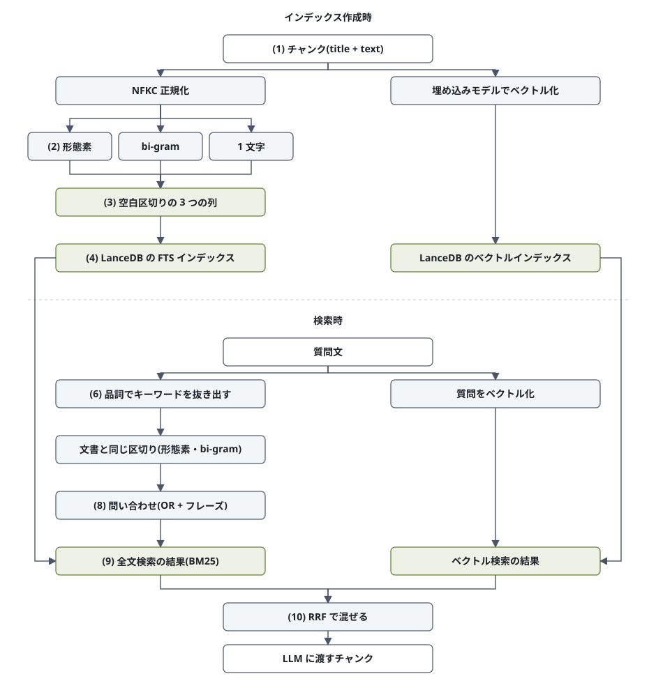

# 段階 5: ハイブリッド検索の解説

段階 5(ハイブリッド検索)では、段階 4 までのベクトル検索に全文検索(BM25)を足し、両方の順位を RRF で混ぜます。
ここで見るのは全文検索の側です。LanceDB に本文をそのまま入れて全文検索のインデックスを張っているのではなく、
手前の Python で形態素解析・bi-gram・1 文字の 3 通りに区切った列を作り、LanceDB にはそれを渡していること、
検索時も質問文から同じ区切りで問い合わせを組み立てていることを、1 つの文書と 1 つの質問を例に順に見ていきます。
検索結果の点や順位はインデックスの作り方や文書の量で変わるので、以下の出力例は一例です。

## 題材

- 文書: 厚生労働省「健康日本21（第二次）参考資料スライド集」のスライド 83(20本以上の歯を有する者の割合の年次推移のグラフ。段階 4 の vision 抽出器がグラフを `図の説明:` 行にしたもの)
- 質問: 「20本以上の歯がある人が6割以下になってしまうのは、資料の最新では何歳ぐらい？」(答えは上のスライドに載っている)

この質問には「歯」という 1 文字の検索語があります。日本語の全文検索でよく使われる bi-gram(2 文字ずつ)では 1 文字の語を引けないので、
この質問で 1 文字の列が要る理由が見えます。

## 前提: LanceDB の全文検索とは

全文検索のインデックス(転置インデックス)は、「どの語がどの文書の何番目にあるか」の表です。文書を**トークン**(語)に区切り、
トークンごとに文書の一覧を持ちます。検索語も同じ規則でトークンに区切り、一覧を引いて、BM25 という式で点を付けて並べます。
BM25 は「検索語がその文書に多く出るほど高く、どの文書にも出る語ほど軽く、長い文書ほど割り引く」点の付け方です。

つまり、**文書と検索語をどう区切るか(トークナイザ)で、何が引けるかが決まります**。LanceDB の既定のトークナイザ `simple` は
空白と句読点で切ります。英語ならこれで単語に分かれますが、日本語は語の間に空白が無いので、句読点までの 1 文がまるごと 1 トークンになり(40 文字を超えると索引にも入りません)、
「割合」のような語では引けません。(5) で実験します。

LanceDB には `ngram`(3 文字ずつ)や、日本語の形態素解析器(lindera)を使う選択肢もありますが、辞書を別途置く必要があったり、
区切り方や表記の正規化を細かく制御できなかったりします。そこでこのリポジトリでは、**区切りは Python 側(`app/advanced_rag/fulltext.py`)で済ませ、
LanceDB には空白区切りの文字列の列を渡して、LanceDB 側は空白で分けるだけ**にしています。実務の Elasticsearch などでも、
日本語は形態素解析(kuromoji、Sudachi)と bi-gram の 2 つの索引を併用するのが定番で、それと同じ構成です。

**ストップワードについて。** 英語の全文検索では the / and のような語(ストップワード)を索引から外すのが普通で、LanceDB の
`remove_stop_words` もその機能です(英語の一覧しかありません)。ここではそれを使わず、文書側では記号・空白だけを落とし、
助詞(「の」「は」)も索引に残します(BM25 の重み付けで自然に軽くなるうえ、語の並び(フレーズ)の一致に要るため)。
その代わり、**質問側で品詞を見て名詞の並びだけをキーワードに残し**、助詞・助動詞・動詞・代名詞を落とします。(6) で見ます。

## 処理の流れ



番号は以下の節に対応します。(1)〜(4) がインデックス作成時(`build_index.py`)、(6)〜(9) が検索時(`rag.py`)の処理で、
(5) は標準のトークナイザで済ませない理由の実験、(10) はベクトル検索と混ぜるところです。

## (1) 入力: DB に登録するチャンク

段階 4 の `ingest.py` が JSONL に書き出したチャンクの 1 件です。`build_index.py` は `title` と `text` を改行でつないだ文字列を、
埋め込み(vector 列)と全文検索の列の両方の元にします。

コード: `app/advanced_rag/ingest.py`

```json
{
  "id": "厚労省資料/健康日本21（第二次）参考資料スライド集#slide83",
  "title": "厚労省資料 / 健康日本21（第二次）参考資料スライド集 / slide83",
  "text": "(下の本文)",
  "collection": "厚労省資料",
  "file": "厚労省資料/健康日本21（第二次）参考資料スライド集.pptx",
  "sheet": "slide83",
  "unit": "slide83",
  "seq": 84
}
```

text(933 文字。先頭を抜粋):

```text
20本以上の歯を有する者の割合の年次推移
図の説明: 縦軸は20本以上の歯を有する者の割合（%）、横軸は年齢階級（歳）。
図の説明: 凡例の年次は昭和62年、平成5年、平成11年、平成17年、平成23年。
図の説明: 40～44歳: 昭和62年 約92% / 平成5年 約93% / 平成11年 約97% / 平成17年 約98% / 平成23年 約99%。
図の説明: 45～49歳: 昭和62年 約81% / 平成5年 約88% / 平成11年 約90% / 平成17年 約95% / 平成23年 約97%。
...
図の説明: 70～74歳: 昭和62年 約15% / 平成5年 約26% / 平成11年 約32% / 平成17年 約43% / 平成23年 約52%。
図の説明: 75～79歳: 昭和62年 約9% / 平成5年 約10% / 平成11年 約18% / 平成17年 約27% / 平成23年 約48%。
...
```

## (2) 形態素解析(Sudachi)

最初に Unicode の NFKC 正規化で全角英数字・全角記号を半角にそろえます(「（第二次）」→「(第二次)」、「１２」→「12」)。
その後、形態素解析器 Sudachi(辞書は `sudachidict-core`)で語に区切ります。分割の単位は**モード C**(最も長い単位)で、
「実態調査」「参考資料」が 1 語になります(短い単位だと「実態 / 調査」に割れて、「調査」だけで当たる文書が増えます)。

Sudachi の形態素 1 つを、次の規則で 1 トークンにします。

- 記号・空白(「/」「:」「、」「(」)は落とす
- 日本語の語は Sudachi の**正規化形**にする。表記ゆれが 1 つにまとまり(「目盛」→「目盛り」、「フィルタ」→「フィルター」、「引落し」→「引き落とし」)、質問と文書の表記が違っても当たる。
  数字も正規化されるので「10万」は「100000」、「二」は「2」になる
- 英数字の語は正規化せず、小文字にするだけ。正規化すると「project」が「プロジェクト」に化けて、識別子として引けなくなるため

コード: `app/advanced_rag/fulltext.py` の `morphs()`

タイトル行と本文 2 行目の例。右端の列が `fts_morph` に入る語です。

タイトル行「厚労省資料 / 健康日本21(第二次)参考資料スライド集 / slide83」:

| 表層 | 品詞 | 正規化形 | `fts_morph` に入る語 |
|---|---|---|---|
| 厚労省 | 名詞-普通名詞-一般 | 厚労省 | 厚労省 |
| 資料 | 名詞-普通名詞-一般 | 資料 | 資料 |
| / | 補助記号-一般 | / | (落とす: 記号) |
| 健康 | 名詞-普通名詞-形状詞可能 | 健康 | 健康 |
| 日本 | 名詞-固有名詞-地名 | 日本 | 日本 |
| 21 | 名詞-数詞 | 21 | 21 |
| 第 | 接頭辞 | 第 | 第 |
| 二 | 名詞-数詞 | 2 | 2 |
| 次 | 接尾辞-名詞的-助数詞 | 次 | 次 |
| 参考資料 | 名詞-普通名詞-一般 | 参考資料 | 参考資料 |
| スライド | 名詞-普通名詞-サ変可能 | スライド | スライド |
| 集 | 接尾辞-名詞的-一般 | 集 | 集 |
| slide | 名詞-普通名詞-一般 | slide | slide |
| 83 | 名詞-数詞 | 83 | 83 |

本文 1〜2 行目「20本以上の歯を有する者の割合の年次推移」「図の説明: 縦軸は20本以上の歯を有する者の割合(%)、横軸は年齢階級(歳)。」(抜粋):

| 表層 | 品詞 | 正規化形 | `fts_morph` に入る語 |
|---|---|---|---|
| 20 | 名詞-数詞 | 20 | 20 |
| 本 | 接尾辞-名詞的-助数詞 | 本 | 本 |
| 以上 | 名詞-普通名詞-副詞可能 | 以上 | 以上 |
| の | 助詞-格助詞 | の | の |
| 歯 | 名詞-普通名詞-一般 | 歯 | 歯 |
| を | 助詞-格助詞 | を | を |
| 有する | 動詞-一般 | 有する | 有する |
| 者 | 名詞-普通名詞-一般 | 者 | 者 |
| の | 助詞-格助詞 | の | の |
| 割合 | 名詞-普通名詞-一般 | 割合 | 割合 |
| … | | | |
| 図 | 名詞-普通名詞-一般 | 図 | 図 |
| の | 助詞-格助詞 | の | の |
| 説明 | 名詞-普通名詞-サ変可能 | 説明 | 説明 |
| : | 補助記号-一般 | : | (落とす: 記号) |
| 縦軸 | 名詞-普通名詞-一般 | 縦軸 | 縦軸 |
| は | 助詞-係助詞 | は | は |
| … | | | |
| 横軸 | 名詞-普通名詞-一般 | 横軸 | 横軸 |
| は | 助詞-係助詞 | は | は |
| 年齢 | 名詞-普通名詞-一般 | 年齢 | 年齢 |
| 階級 | 名詞-普通名詞-一般 | 階級 | 階級 |
| ( | 補助記号-括弧開 | ( | (落とす: 記号) |
| 歳 | 名詞-普通名詞-副詞可能 | 年 | 年 |
| ) | 補助記号-括弧閉 | ) | (落とす: 記号) |

「歳」が正規化形「年」になっているのは、Sudachi の辞書が「歳」と「年」を同じ語とみなしているためです(質問の「平成23年」の「年」とも同じ語になります)。

助詞の「の」「は」は落とさずに入れています(前提の節のとおり)。

Sudachi の `Tokenizer` はスレッドで同時に使えないので、スレッドごとに 1 つ作っています(Weave の評価は `predict` を並列に呼ぶため)。
また 1 回に渡す文字数を 4,000 文字で区切っています(Sudachi の入力長の上限のため)。

## (3) 3 つの列に区切る

形態素だけだと、辞書の区切りと検索語の区切りが合わないときに取りこぼします(複合語の一部、ID の一部、辞書に無い語)。
そこで辞書に頼らない bi-gram も併用し、さらに bi-gram で引けない 1 文字の語のために 1 文字の列も作ります。
チャンク 1 件から次の 3 列を作り、それぞれ空白区切りの 1 つの文字列にします。

| 列 | 区切り方 | 例(タイトル行) |
|---|---|---|
| `fts_morph` | (2) の形態素 | `厚労省 資料 健康 日本 21 第 2 次 参考資料 スライド 集 slide 83` |
| `fts_bigram` | かな漢字の並びを 2 文字ずつ重ねて切る。英数字の語(`_ - . /` でつながったものを含む)はそのまま 1 語 | `厚労 労省 省資 資料 健康 康日 日本 21 第二 二次 参考 考資 資料 料ス スラ ライ イド ド集 slide83` |
| `fts_unigram` | かな漢字を 1 文字ずつ(英数字は入れない) | `厚 労 省 資 料 健 康 日 本 第 二 次 参 考 資 料 ス ラ イ ド 集` |

bi-gram は Lucene / Elasticsearch の CJK bi-gram と同じ方式で、小文字にした上で正規表現 `RUN` が「英数字の語」と「かな漢字の並び」を
取り出し、かな漢字の並びだけを 2 文字ずつにします。英数字の語は `project_name` や `e-Gov` のように記号でつながっていれば 1 語のままなので、
識別子をそのまま引けます。形態素の列では Sudachi が `project` `name` に割るので、(8) の問い合わせでは形態素の列を `project name` の並びで、
bi-gram の列を `project_name` の 1 語で引くことになり、どちらの書き方の文書でも当たります。

コード: `app/advanced_rag/fulltext.py` の `columns()`、`bigrams()`、`unigrams()`

この文書では、トークン数は次のとおりでした。

| 列 | トークン数 |
|---|---|
| `fts_morph` | 413 |
| `fts_bigram` | 442 |
| `fts_unigram` | 398 |

## (4) LanceDB のテーブルと FTS インデックス

`build_index.py` は、チャンクのメタ情報・本文・埋め込み(`vector`)に (3) の 3 列を足した行で LanceDB のテーブルを作り、
3 列それぞれに全文検索(FTS)のインデックスを張ります。

コード: `app/advanced_rag/build_index.py`

```python
rows = [{**d, **fulltext.columns(f"{d['title']}\n{d['text']}"), "vector": v.tolist()} for d, v in zip(docs, vectors)]
table = db.create_table(table_name(extractor), data=rows)
for column in fulltext.ALL_COLUMNS:  # fts_morph, fts_bigram, fts_unigram
    table.create_index(column, replace=True, config=FTS(
        base_tokenizer="whitespace", with_position=True, max_token_length=None,
        lower_case=False, stem=False, remove_stop_words=False, ascii_folding=False,
    ))
```

設定の意味:

- `base_tokenizer="whitespace"`: 空白で分けるだけ。区切りは済んでいるので、LanceDB には何もさせない(既定の `simple` だと句読点でも切るので、`project_name` が割れる)
- `with_position=True`: トークンの位置も索引に入れる。(8) のフレーズ一致(語の並びの一致)に要る
- `max_token_length=None`: 長いトークンを捨てない(既定は 40 文字で、長い URL や ID が落ちる)
- `lower_case` / `stem` / `remove_stop_words` / `ascii_folding` はすべて無効: 小文字化は (2)(3) で済んでいて、語幹・ストップワード・アクセント記号の処理は英語向けなので使わない

テーブルのスキーマと、インデックスの大きさ(この例では 1,327 行):

```text
id, title, text, collection, file, sheet, unit, seq   … メタ情報と本文
fts_morph, fts_bigram, fts_unigram                    … 全文検索用(検索結果から LLM に渡すときは外す)
vector: fixed_size_list<float>[1536]                  … text-embedding-3-small の埋め込み
```

| インデックス | 大きさ |
|---|---|
| `fts_morph_idx` | 1.9 MB |
| `fts_bigram_idx` | 4.3 MB |
| `fts_unigram_idx` | 2.4 MB |

## (5) 標準のトークナイザで済ませない理由(実験)

同じ 1,327 件の `title + text`(区切っていない文字列)に、LanceDB 標準のトークナイザで別のテーブルに索引を張って検索した結果です。
「本文に含む」は、当たった文書の本文に検索語がそのまま含まれている件数です。

| 検索語 | `simple`(既定) | `ngram`(3 文字) | このリポジトリ |
|---|---|---|---|
| 歯 | 4 件(「歯・口腔」のように記号で区切られて単独のトークンになっていた箇所だけ) | 0 件(3 文字未満) | 12 件(本文に含む 12 件) |
| 割合 | 1 件(同じく単独のトークンになっていた 1 件だけ) | 0 件(3 文字未満) | 42 件(本文に含む 42 件) |
| 歯科疾患実態調査 | 0 件 | — | 77 件(本文に含む 2 件が上位 2 位) |
| 20 | — | 0 件(3 文字未満) | — |
| ER2000123(文書に無い ID) | 0 件 | **148 件**(本文に含む 0 件) | 6 件(本文に含む 0 件) |

- `simple` は日本語の文を句読点まで 1 トークンにするので、「20本以上の歯を有する者の割合」のように文の途中にある「歯」「割合」は引けません
- `ngram` は検索語も 3 文字ずつに割って OR で探すだけなので、`ER2000123` を「200」「000」「123」のかけらで含む 148 件に当たります。
  並び(フレーズ)の一致が効かず、2 文字以下の語(「歯」「割合」「20」)は引けません
- このリポジトリの区切りでは、「割合」「歯科疾患実態調査」は bi-gram の OR で広く拾いつつフレーズ一致の加点で本文に含む文書が上位に来ます
  (「歯科疾患実態調査」は 77 件当たりますが、本文にそのまま含むスライド 83・84 が 1 位・2 位です)。
  `ER2000123` は 6 件当たっていますが、これは形態素の列で Sudachi が `ER` と `2000123` に割り、`er` の方が当たったものです(bi-gram の列では `er2000123` が 1 語なので当たりません)

## (6) 質問からキーワードを抜き出す

検索時は、質問文をそのまま検索語にはしません。「どれですか」「高かった」のような語が入ると、それを含むだけの文書が点を得るためです。
Sudachi の品詞を見て、**名詞(と、それに付く接頭辞・接尾辞)が続いている部分を、元の表記のまま 1 語**にします。
LLM にキーワードを書かせる方法もありますが、ここでは速くて結果が揺れない品詞による方法にしています。

- 助詞・助動詞・動詞・形容詞・代名詞・記号は落とす
- 「場合」「とき」「ごろ」のような副詞的な名詞(Sudachi の「副詞可能」)と、「いくつ」「いくら」「いつ」は、単独なら落とし、ほかの名詞に続いていれば残す(「20本以上」の「以上」)
- 英数字の間の `_ - . /` は識別子の一部として続ける(`project_name`、`e-Gov`)
- 同じ語は 1 回にする

コード: `app/advanced_rag/fulltext.py` の `keywords()`

質問「20本以上の歯がある人が6割以下になってしまうのは、資料の最新では何歳ぐらい？」:

| 表層 | 品詞 | 判定 |
|---|---|---|
| 20 | 名詞-数詞 | 残す(内容語) |
| 本 | 接尾辞-名詞的-助数詞 | 残す(内容語) |
| 以上 | 名詞-普通名詞-副詞可能 | 残す(内容語)。副詞可能なので、単独なら落とす |
| の | 助詞-格助詞 | 落とす(助詞) |
| 歯 | 名詞-普通名詞-一般 | 残す(内容語) |
| が | 助詞-格助詞 | 落とす(助詞) |
| ある | 動詞-非自立可能 | 落とす(動詞) |
| 人 | 名詞-普通名詞-一般 | 残す(内容語) |
| が | 助詞-格助詞 | 落とす(助詞) |
| 6 | 名詞-数詞 | 残す(内容語) |
| 割 | 名詞-普通名詞-助数詞可能 | 残す(内容語) |
| 以下 | 名詞-普通名詞-一般 | 残す(内容語) |
| に | 助詞-格助詞 | 落とす(助詞) |
| なっ | 動詞-非自立可能 | 落とす(動詞) |
| て | 助詞-接続助詞 | 落とす(助詞) |
| しまう | 動詞-非自立可能 | 落とす(動詞) |
| の | 助詞-準体助詞 | 落とす(助詞) |
| は | 助詞-係助詞 | 落とす(助詞) |
| 、 | 補助記号-読点 | 落とす(補助記号) |
| 資料 | 名詞-普通名詞-一般 | 残す(内容語) |
| の | 助詞-格助詞 | 落とす(助詞) |
| 最新 | 名詞-普通名詞-一般 | 残す(内容語) |
| で | 助詞-格助詞 | 落とす(助詞) |
| は | 助詞-係助詞 | 落とす(助詞) |
| 何歳 | 名詞-普通名詞-一般 | 残す(内容語) |
| ぐらい | 助詞-副助詞 | 落とす(助詞) |
| ? | 補助記号-句点 | 落とす(補助記号) |

残した語をつなぐと、キーワードは「20本以上 歯 人 6割以下 資料 最新 何歳」になります。

名詞(と接尾辞)が続いている「20 / 本 / 以上」「6 / 割 / 以下」は、それぞれ 1 語「20本以上」「6割以下」にまとまります。
これは (8) で「この並びのまま文書にあれば加点する」単位になります。「以上」は副詞可能の名詞ですが、「20本」に続いているので残っています。
「資料」「最新」「何歳」のように、文書の本文には出てこない語も残りますが、どの文書にも当たらないか、当たっても点が小さいので害はありません。

## (7) ほかの質問での例

同じ処理をほかの質問文にかけた結果です。質問の表現が変わっても安定して名詞だけが残ることと、
取りこぼしの例(「読み取り専用」が「専用」になる、「該当するプロジェクトが無い場合」が「該当 プロジェクト」になる)も見えます。

```text
LibreOffice でファイルを開くときのパスワードとは別に、編集を制限する(読み取り専用で開かせる)パスワードを設定するには?
     -> LibreOffice ファイル パスワード 別 編集 制限 専用 設定
e-Gov で提出した労働保険の申請について、電子納付の期限はどこで確認できますか?
     -> e-Gov 提出 労働保険 申請 電子納付 期限 確認
プロジェクト検索画面で「検索」ボタンを押したときの処理を、入力チェックから検索結果の表示（該当するプロジェクトが無い場合を含む）まで順に教えてください
     -> プロジェクト検索画面 検索 ボタン 処理 入力チェック 検索結果 表示 該当 プロジェクト 順
```

## (8) 問い合わせの組み立て

キーワードを (2)(3) と**同じ関数**(`morphs()` / `bigrams()`)で区切り、LanceDB の問い合わせオブジェクトを組み立てます。
文書側と同じ関数で区切ることが肝心で、たとえば Sudachi は「カラム」を正規化形「コラム」にしますが、文書側も同じく「コラム」で索引されているので当たります。

返すのは、次の句をすべて SHOULD(OR)でつないだ `BooleanQuery` で、各句の点を足した合計が BM25 の点になります。

- `MatchQuery`(列ごとに 1 つ): 区切った語の OR。1 語でも含めば当たり、広く拾う
- `PhraseQuery`(キーワードごと): 語の並びがそのまま一致した文書に加点。2 語以上になるキーワードだけ
- かな漢字 1 文字の語(「歯」「者」)は bi-gram の列には無いので、`fts_unigram` に `MatchQuery` で引く

Elasticsearch の `match`(OR)と `match_phrase` を bool / should で合わせる定番の形と同じです。フレーズ一致だけにすると、
質問の複合語が文書にそのままの形で無いとき(質問は「顧客登録API」、文書は「顧客の登録API」)に取りこぼすので、OR も残しています。

コード: `app/advanced_rag/fulltext.py` の `query()`

```text
キーワード: 20本以上 歯 人 6割以下 資料 最新 何歳

BooleanQuery(すべて SHOULD = OR。各句の点を足す)
  MatchQuery  fts_morph    20 本 以上 歯 人 6 割 以下 資料 最新 何歳   # 語の OR(BM25)
  PhraseQuery fts_morph    20 本 以上   # 並びの一致で加点
  PhraseQuery fts_morph    6 割 以下   # 並びの一致で加点
  MatchQuery  fts_unigram  歯 人   # 語の OR(BM25)
  MatchQuery  fts_bigram   20 本以 以上 6 割以 以下 資料 最新 何歳   # 語の OR(BM25)
  PhraseQuery fts_bigram   20 本以 以上   # 並びの一致で加点
  PhraseQuery fts_bigram   6 割以 以下   # 並びの一致で加点
```

1 文字の語「歯」「人」が `fts_unigram` に回っていることと、「20本以上」が形態素の列では「20 本 以上」、bi-gram の列では「20 本以 以上」の並びになっていることが分かります。

## (9) 全文検索の結果

段階 5 の設定どおり資料群(`collection`)で先に絞ってから、`table.search(query, query_type="fts")` で上位 50 件を取ります。
点は BM25 の合計です。

コード: `app/advanced_rag/rag.py` の `_fts_hits()`

答えの載っているスライド 83 が 1 位です。「20本以上」のフレーズ一致が効いて、2 位に 2 倍近い差を付けています。2 位以下は「歯」「人」「割」を含むほかのスライドで、2 位のスライド 84(歯周ポケット)と 5 位のスライド 86(12 歳児のう歯数)は同じ歯・口腔の章のグラフです。

```text
順位       BM25  id
1       87.07  厚労省資料/健康日本21（第二次）参考資料スライド集#slide83
2       44.60  厚労省資料/健康日本21（第二次）参考資料スライド集#slide84
3       44.59  厚労省資料/健康日本21（第二次）参考資料スライド集#slide80
4       43.13  厚労省資料/健康日本21（第二次）参考資料スライド集#slide67-68
5       40.51  厚労省資料/健康日本21（第二次）参考資料スライド集#slide86
```

全文検索は語の出現で点を付けるので、検索語を何度も書いているだけの別の文書が上に来ることもあります。
それを補うのが (10) のベクトル検索との混合と、段階 6 の並べ直し（Decisions API で、チャンクごとに質問の答え・手がかりがあるかを判定して点を付ける）です。

1 文字の列が要る理由は、「歯」だけを列ごとに引くと分かります。bi-gram の列には「歯」という 1 文字のトークンが無いので 0 件、1 文字の列なら当たります(上位 5 件を表示)。

```text
検索語「歯」を列ごとに MatchQuery で引く

fts_bigram: 0 件
fts_unigram: 5 件
    9.95  厚労省資料/健康日本21（第二次）参考資料スライド集#slide81
    9.59  厚労省資料/健康日本21（第二次）参考資料スライド集#slide84
    9.02  厚労省資料/健康日本21（第二次）参考資料スライド集#slide67-68
    8.94  厚労省資料/健康日本21（第二次）参考資料スライド集#slide86
    8.66  厚労省資料/健康日本21（第二次）参考資料スライド集#slide83
```

## (10) ベクトル検索と混ぜる(RRF)

段階 5 の `search="hybrid"` では、ベクトル検索(質問の埋め込みとのコサイン類似度)と全文検索の上位 50 件ずつを、
順位だけを使う RRF(Reciprocal Rank Fusion)で 1 つの順位にします。文書の点は各検索での `1 / (k + 順位)` の和で、`k = 5` です
(よく使われる 60 より小さく、各検索の上位をより強く効かせる設定)。点の尺度が違う BM25 とコサイン類似度を、順位に直すことで混ぜられます。

コード: `app/advanced_rag/rag.py` の `retrieve()`

```text
## RRF で混ぜた上位 5 件(段階 5 が LLM に渡すチャンク)
1      0.3333  厚労省資料/健康日本21（第二次）参考資料スライド集#slide83   (vector 1 位 / fts 1 位)
2      0.2857  厚労省資料/健康日本21（第二次）参考資料スライド集#slide84   (vector 2 位 / fts 2 位)
3      0.2250  厚労省資料/健康日本21（第二次）参考資料スライド集#slide86   (vector 3 位 / fts 5 位)
4      0.1778  厚労省資料/健康日本21（第二次）参考資料スライド集#slide67-68   (vector 10 位 / fts 4 位)
5      0.1726  厚労省資料/健康日本21（第二次）参考資料スライド集#slide80   (vector 16 位 / fts 3 位)
```

1 位の点 0.3333 は `1/(5+1) + 1/(5+1)` です。LLM に渡すときは、`fts_morph` などの検索用の列と LanceDB が付けた距離・点は外し、
`title` と `text` だけを渡します。

---

この資料で引用しているスライドの本文(グラフから抽出した値)は、次の著作物を加工したものです。

**健康日本21（第二次）参考資料スライド集**

- 作成者: 厚生労働省
- 入手元: https://www.mhlw.go.jp/bunya/kenkou/dl/kenkounippon21_sura.pptx ([健康日本21（第二次）](https://www.mhlw.go.jp/stf/seisakunitsuite/bunya/kenkou_iryou/kenkou/kenkounippon21.html)の「普及啓発用資料」)
- ライセンス: [公共データ利用規約(第1.0版)(PDL1.0)](https://www.digital.go.jp/resources/open_data/public_data_license_v1.0)(CC BY 4.0 と互換)
- 改変: スライド 83 のグラフを AI で読み取って文にし、形態素・bi-gram に区切ったものです。原本の図表そのものではありません
- 出典: 厚生労働省「健康日本21（第二次）参考資料スライド集」(https://www.mhlw.go.jp/bunya/kenkou/dl/kenkounippon21_sura.pptx)を加工して作成
